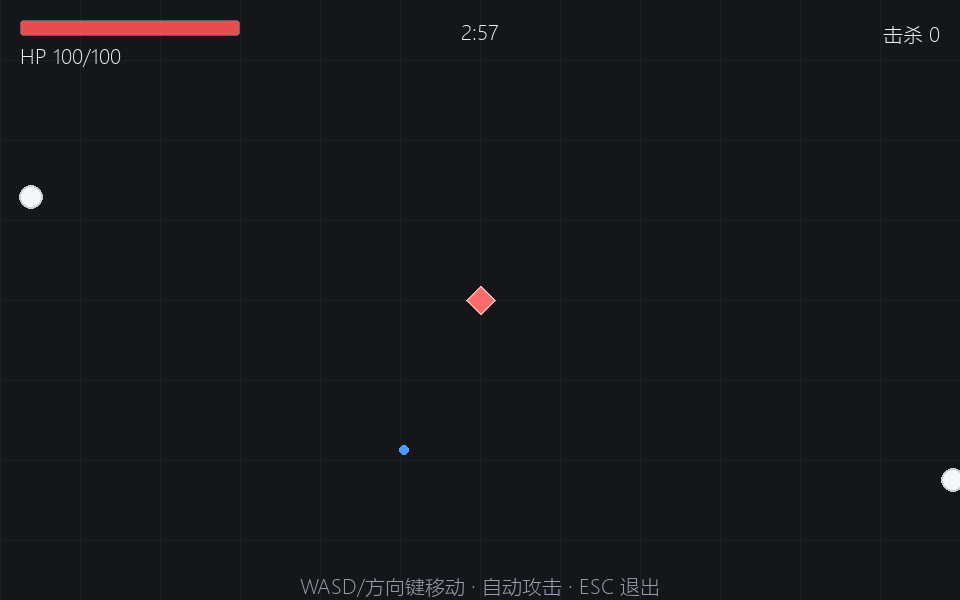
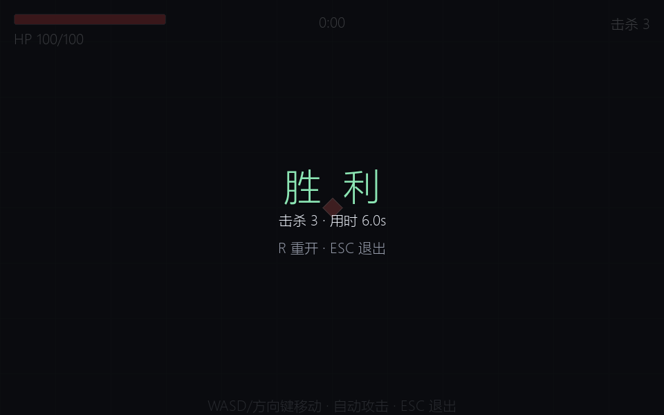

# vsproto — Vampire Survivors 超小原型

3 分钟一局，自动索敌，无升级、无回血。用来验证「规格 → 实现 → 验证」这条流水线，不是用来做完整游戏的。



## 运行

```powershell
uv sync
uv run vsproto
```

## 操作

| 键 | 作用 |
|---|---|
| WASD / 方向键 | 移动 |
| R | 结束后重开 |
| ESC | 退出 |

自动攻击：每 0.45 秒向范围内最近的敌人发射一枚蓝色子弹。

## 规则

- 场地 2400×2400，镜头跟随主角
- 敌人白色圆形，恒定速度 65 px/s 向你靠近，每 0.55 秒生成一个
- 主角浅红菱形，100 血；碰敌人扣 12 血，0.6 秒无敌帧
- 180 秒到点：清空场上敌人，胜利
- 血量归零：失败，不能继续

## 验证

```powershell
uv run pytest                 # 纯逻辑单测（不依赖 pygame 窗口）
uv run python scripts/verify.py   # 无头启动 + 截图 + 像素级断言 + JSON 报告
```

`scripts/verify.py` 就是本仓库的「验证技能」：它真的把游戏跑起来、渲染、截图、检查像素，而不是只测函数。



最近一次结果：11 个单测全过，无头验证 19/19（含真实入口 60 帧冒烟），完整 180 秒模拟 0.2 秒。

## 工作流

这个仓库是「DSH 自动开发流水线」的第一个真实样本：

| 文件 | 作用 |
|---|---|
| `AGENTS.md` | 仓库宪法：分层禁令、完成定义、已知设计决定 |
| `docs/agents/specs/sp-20261017-001.md` | 本次的规格与验收标准 |
| `docs/agents/journal/2026-10-17.md` | 交付记录与关键决定 |
| `docs/agents/backlog/2026-10-17.md` | 后续工作（只记录不修） |
| `.dsh/skills/verify-game/SKILL.md` | 验证技能：怎么跑、验什么、怎么加检查 |

流程：`backlog → spec(G1) → build(G2) → verify(G3) → 人合并`。当前处于"人合并"阶段，没有开启自动合并。

## 结构

```
src/vsproto/
  config.py    参数（场地、速度、伤害、时长）
  world.py     纯逻辑模拟，不 import pygame，可确定性重放
  render.py    只负责画
  app.py       窗口、输入、主循环
scripts/verify.py   无头验证
tests/          逻辑单测
docs/agents/    规格、backlog、journal
```
